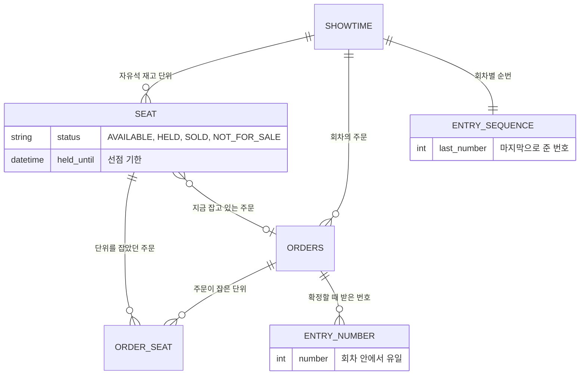

# 0002. 자유석 재고와 입장번호 배정

- 상태: 채택
- 날짜: 2026-11-15
- 관련: #43, [기능 명세](../spec/booking-flow.md) 7절, [API 명세](../spec/booking-api.md) 6절

## 맥락

- 자유석은 자리를 정하지 않고 팔고, 구매자는 입장번호 순서로 들어간다. 기능 명세(#30)는 자유석 좌석마다 입장번호를 붙여 두고, 선점할 때 남은 번호 가운데 가장 앞 번호부터 주기로 했다
- 이 방식에는 문제가 세 가지 있다
  - 판매가 열리는 순간 모든 선점이 같은 앞 번호 좌석 행을 잠그려 한다. 번호 순서를 지키려면 잠긴 행을 건너뛸 수 없어서 요청이 한 줄로 선다
  - 선점이 만료되거나 취소되면 그 번호가 다시 비고, 다음에 선점한 사람이 그 번호를 받는다. 늦게 온 사람이 앞 번호로 들어간다
  - 빈 번호가 끝까지 다시 팔리지 않으면 입장 순서에 구멍이 남는다
- 선점 만료는 정리 배치 없이 선점 기한으로 판단한다(#26). 재고를 나타내는 방법은 저장된 상태를 바꾸지 않아도 남은 수가 맞아야 한다
- 지금 `seat` 테이블은 지정석과 자유석이 함께 쓴다. 수량으로 선점하는 자유석 자동 배정은 아직 구현하지 않았다. 지금 선점 API는 좌석 종류를 검사하지 않아 자유석 좌석 ID를 `seatIds`로 보내도 선점된다. 로컬 샘플 데이터는 자유석 행의 `label`에 `1`부터 시작하는 숫자를 넣는다

## 결정

1. 자유석 좌석 행은 번호가 없는 재고 단위다. 회차의 자유석 정원만큼 행을 두고 행끼리 구분하지 않는다. 판매하지 않는 수량은 지금처럼 `NOT_FOR_SALE` 행으로 둔다
2. 재고 단위의 상태와 전이는 지정석과 같다. 선점은 남은 단위 가운데 요청한 수만큼을 잡는다. 남은 단위는 `AVAILABLE`이거나 선점 기한이 지난 `HELD`인 행이다. 남은 수가 요청한 수보다 적으면 주문 전체를 거부한다
3. 입장번호는 확정할 때 준다. 회차마다 1부터 시작하는 순번을 두고, 확정하는 주문은 수량만큼 이어진 다음 번호를 받는다
4. 입장번호는 재고 단위가 아니라 주문에 기록한다. 순번을 올리는 것과 번호를 기록하는 것은 확정과 같은 트랜잭션에서 한다. 확정이 실패해 되돌려지면 순번도 함께 되돌려진다
5. 한 번 준 번호는 바꾸지 않고 다시 쓰지 않는다. 확정 뒤의 취소는 환불이고 결제(P2)에서 다룬다. 환불로 빈 번호도 다른 주문에 주지 않는다
6. 이미 확정한 주문을 다시 확정하면 번호를 새로 주지 않고 처음 받은 번호를 돌려준다
7. 선점 중인 주문에는 입장번호가 없다. 화면은 번호 대신 수량과 "확정하면 입장번호가 나온다"는 안내를 보여 준다

동작마다 재고 단위와 주문이 바뀌는 것은 다음과 같다.

| 동작 | 재고 단위 | 주문 |
|---|---|---|
| 선점 | 남은 단위 가운데 요청한 수만큼이 `HELD`가 된다 | `HELD`로 생긴다 |
| 선점 기한이 지남 | 저장된 상태는 그대로다. 기한부터 남은 수에 든다 | 저장된 상태는 그대로다. 확정할 수 없다 |
| 기한이 지난 단위를 다른 주문이 선점 | 새 주문에 속한다 | 이전 주문이 `EXPIRED`가 된다 |
| 선점 취소 | 바로 `AVAILABLE`이 된다 | `CANCELLED`가 된다 |
| 확정 | `SOLD`가 된다 | `CONFIRMED`가 되고 입장번호를 받는다 |
| 확정 뒤 취소(환불) | 다시 팔 수 있게 된다 | 받은 번호는 주문에 남는다 |

### 지키는 조건

- 한 회차에서 확정한 좌석 수와 기한 안의 선점 좌석 수를 더한 값은 판매하는 재고 단위 수를 넘지 않는다. 재고 단위 하나는 한 시점에 한 주문에만 속한다
- 한 회차에서 같은 입장번호는 한 주문에만 있다. (회차, 입장번호)에 유일 제약을 둔다
- 확정한 자유석 주문이 가진 입장번호의 수는 주문 수량과 같다. 확정하지 않은 주문에는 입장번호가 없다
- 회차의 순번은 줄어들지 않는다

### 관계

`ENTRY_SEQUENCE`와 `ENTRY_NUMBER`는 새로 필요한 저장소를 나타낸 것이다. 테이블과 컬럼 이름은 자유석 자동 배정 이슈에서 정한다.

### 지금 `seat` 테이블과 달라지는 점

- 자유석 행의 `label`은 입장번호가 아니고 구매자에게 보여 주지 않는다. `(showtime_id, label)` 유일 제약이 있어서, 행을 구분하는 내부 값을 넣을지 `NULL`을 허용할지는 자유석 자동 배정 이슈에서 마이그레이션과 함께 정한다
- 자유석 선점은 좌석 ID가 아니라 수량을 받는다. 서버가 남은 단위에서 수량만큼 고른다
- 회차별 순번의 현재 값과 주문이 받은 입장번호를 저장할 곳이 새로 필요하다
- `status`, `current_order_id`, `held_until`과 좌석 상태 CHECK 제약(`V3`)은 그대로 쓴다. 지정석 행은 바뀌지 않는다

## 버린 대안

- **선점할 때 남은 번호 가운데 가장 앞 번호를 주기(지금까지의 명세)**: 맥락에 적은 세 문제가 생긴다
- **선점할 때 순번을 주고 만료되면 그 번호를 버리기**: 앞 번호 행에 몰리는 문제는 없어지지만, 확정하지 않은 선점마다 번호가 하나씩 빈다. 선점만 하고 떠나는 사람이 많을수록 입장 순서의 구멍이 늘어난다
- **회차에 선점 수와 판매 수 카운터를 두기**: 선점 만료를 배치 없이 기한으로 판단하므로 기한이 지나도 카운터가 스스로 줄지 않는다. 선점할 때마다 기한이 지난 주문을 찾아 카운터를 고쳐야 하고, 주문과 카운터라는 두 기록이 어긋날 수 있다
- **좌석 행 없이 주문 수량의 합으로 남은 수를 계산하기**: 기록은 주문 하나뿐이라 어긋날 일은 없다. 그러나 합계를 믿으려면 회차 단위로 잠가야 해서 한 회차의 모든 선점이 한 줄로 선다. 선점·만료·확정·1인 최대 좌석 수 규칙도 지정석용과 자유석용 두 벌이 된다
- **환불로 빈 번호를 다음 확정에 주기**: 나중에 산 사람이 앞 번호를 받아 번호가 입장 순서를 뜻하지 않게 된다. 환불한 주문의 티켓 이미지가 남아 있으면 같은 번호의 표가 두 장 돌아다닌다

## 결과

- 입장 순서는 확정한 순서다. 먼저 선점해도 늦게 확정하면 뒷번호를 받는다. 결제가 들어오면 결제 승인이나 입금 확인 순서가 입장 순서가 된다
- 한 주문의 여러 장은 이어진 번호를 받는다
- 가장 큰 입장번호가 정원보다 클 수 있다. 환불된 표가 다시 팔리면 새 번호를 받는다. 입장번호는 순서이고 자리 수가 아니다
- 구매자는 선점 중에 자기 번호를 모른다. 확정 응답에서 처음 받는다
- 지정석과 자유석이 같은 상태 전이를 쓴다. 선점, 만료, 확정, 1인 최대 좌석 수 규칙을 좌석 종류별로 나누지 않는다
- 좌석 조회(`GET /api/showtimes/{showtimeId}/seats`)는 자유석 행의 `label`도 돌려주지만 그 값은 입장번호가 아니다. 이 API는 지정석 좌석 배치(P3)와 함께 바꾼다
- 같은 회차의 확정은 순번을 받는 동안 차례를 기다린다. 확정은 선점보다 드물게 온다고 보고 받아들였고, 이것은 측정하지 않은 가설이다. 전략 비교 + 부하 테스트 단계(P1)에서 잰다

## 구현에서 확인할 것

자유석 자동 배정 이슈에서 정하고 동시성 테스트로 확인한다. 아래는 확인하기 전의 가설이다.

- 재고 단위는 어느 행이든 같아서, 다른 요청이 잠근 행을 기다리지 않고 건너뛰어 고를 수 있다(MySQL의 `FOR UPDATE SKIP LOCKED`). 이렇게 하면 건너뛴 행을 잡고 있던 요청이 되돌려질 때 남은 수가 있는데도 선점이 거부될 수 있다. 초과 판매는 아니고, 화면은 남은 수를 다시 받아, 고른 수량 이상이면 같은 수량으로 다시 시도하게 한다(기능 명세 8절). 쓸지 말지와 거부가 얼마나 생기는지는 테스트와 측정으로 정한다
- InnoDB는 외래 키를 검사할 때 참조하는 행에 공유 잠금을 건다. 순번을 `showtime` 행에 두면 그 회차의 선점(주문을 넣을 때 `showtime` 행에 공유 잠금)과 확정(순번을 올릴 때 배타 잠금)이 서로 기다린다. 순번은 선점이 건드리지 않는 별도 행에 두는 쪽을 먼저 검토한다
- 잠금 순서는 구매자 잠금 → 좌석 → 주문 → 회차 순번이다. 선점은 회차 순번을 잠그지 않는다
- 동시성 테스트로 볼 것: 남은 수보다 많은 수량을 동시에 선점해도 정원을 넘지 않는다, 같은 회차의 여러 주문을 동시에 확정해도 번호가 겹치거나 비지 않는다, 같은 주문을 동시에 여러 번 확정해도 번호는 한 번만 배정된다

자유석 자동 배정(#45)에서 이렇게 정했다.

- 잠긴 행을 건너뛰는 선점(`FOR UPDATE SKIP LOCKED`)을 쓴다. 남은 행을 ID 순으로 요청한 수만큼 잡고, 모자라면 주문 전체를 거부한다. 건너뛴 행 때문에 생기는 거부가 얼마나 되는지는 전략 비교 + 부하 테스트 단계(P1)에서 잰다
- 회차 순번은 별도 테이블 `showtime_entry_sequence`에 두고, 확정할 때 수량만큼 올린다. 입장번호는 `order_entry_number`에 번호마다 한 행으로 기록하고 (회차, 번호)에 유일 제약을 둔다
- 잠금 순서는 가설대로 구매자 잠금 → 좌석 → 주문 → 회차 순번이다. 선점 요청 식별자(#46)를 더하면서 선점은 그보다 먼저 요청 기록의 유일 키를 잡는다
- 위 세 가지 동시성 테스트를 MySQL에서 통과했다
- 자유석 행의 `label`은 지금의 내부 값을 그대로 두고 구매자에게 보여 주지 않는다
