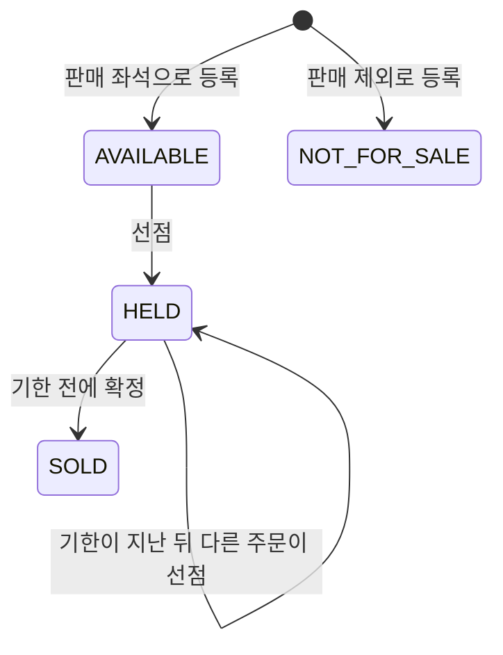
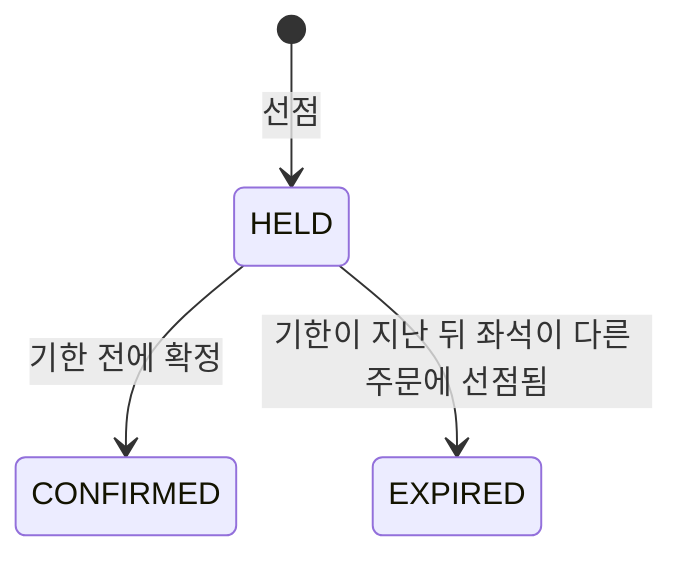

# 좌석 예매 흐름 기능 명세

기본 예약 흐름(P0)에서 구매자가 좌석을 고르고, 선점하고, 확정하기까지의 규칙을 정한다. 왜 이 서비스를 만드는지와 사용자, 제품 원칙은 [PRD](../product/prd.md)에 있다.

- 이 문서는 제품이 어떻게 동작하는지를 다룬다. 잠금 방식이나 격리 수준 같은 구현 방법은 다루지 않는다
- 규칙이 바뀌면 코드와 이 문서를 같은 PR에서 고친다

## 1. 범위

### 다루는 것

- 회차의 좌석 상태 조회
- 여러 좌석을 한 주문으로 선점하기
- 선점 기한이 지난 좌석의 만료와 재판매
- 선점한 주문의 확정
- 위 동작들이 동시에 일어날 때 지켜야 할 결과

### 이번 단계에서 다루지 않는 것

- 결제. 이번 단계에서는 구매자가 확정을 직접 요청한다. 결제가 들어오면(P2) 결제 승인이나 입금 알림이 같은 확정을 요청한다
- 주최자 기능. 공연·회차·좌석은 로컬 개발용 샘플 데이터로 만든다
- 환불, 입장 확인, 현장 판매

## 2. 용어

| 용어 | 뜻 |
|---|---|
| 공연 | 작품 하나. 제목을 가진다 |
| 회차 | 공연이 열리는 한 번. 시작 시각과 판매 조건(판매 시작 시각, 선점 유지 시간, 1인 최대 좌석 수)을 가진다 |
| 좌석 | 회차에서 팔 수 있는 한 자리. 지정석과 자유석이 있다 |
| 지정석 | 정해진 자리. 좌석 번호(예: `A1`)로 구분한다 |
| 자유석 | 자리 대신 입장 순서를 파는 표. 입장번호(예: `1`, `2`)로 구분하고, 지정석과 같은 규칙으로 판다 |
| 선점 | 구매자가 결제나 확정 전에 좌석을 잠시 잡아 두는 것. 선점 기한까지 다른 사람이 살 수 없다 |
| 선점 기한 | 선점이 유효한 마지막 순간. 선점한 시각에 회차의 선점 유지 시간을 더한 값이다 |
| 주문 | 한 번의 선점 요청으로 잡은 좌석 묶음. 주문 단위로 확정한다 |
| 확정 | 선점한 주문을 판매로 굳히는 것. 확정한 좌석은 다시 팔리지 않는다 |
| 판매 제외 좌석 | 주최자가 팔지 않기로 한 좌석. 시야 제한석이나 현장 판매분 등 |

## 3. 구매 흐름

1. 구매자가 회차의 좌석 상태를 조회한다
2. 좌석을 하나 이상 골라 선점을 요청한다. 고른 좌석을 모두 선점할 수 있을 때만 주문이 만들어진다
3. 선점 기한 안에 주문을 확정한다
4. 기한 안에 확정하지 않으면 그 좌석은 기한부터 다시 팔린다

## 4. 상태와 전이

### 좌석 상태

| 상태 | 뜻 | 구매자에게 보이는 상태 |
|---|---|---|
| `AVAILABLE` | 선점할 수 있다 | `AVAILABLE` |
| `HELD` | 어떤 주문이 선점 중이다 | 기한 전이면 `HELD`, 기한부터는 `AVAILABLE` |
| `SOLD` | 확정되어 팔렸다 | `SOLD` |
| `NOT_FOR_SALE` | 판매하지 않는다 | `NOT_FOR_SALE` |

- 기한이 지난 `HELD` 좌석은 저장된 상태를 바꾸지 않아도 선점할 수 있는 좌석으로 본다. 조회에서도 `AVAILABLE`로 보여 준다
- `SOLD`와 `NOT_FOR_SALE`은 시각과 관계없이 선점할 수 없다

### 주문 상태

| 상태 | 뜻 |
|---|---|
| `HELD` | 좌석을 선점 중이다. 기한이 지나면 더 이상 확정할 수 없다 |
| `EXPIRED` | 기한이 지나 그 주문의 좌석이 다른 주문에 다시 선점됐다 |
| `CONFIRMED` | 확정됐다 |

- 기한이 지났지만 아무도 다시 선점하지 않은 주문은 `HELD`로 남는다. 이 주문은 확정할 수 없고 1인 최대 좌석 수에도 세지 않는다
- `EXPIRED`와 `CONFIRMED`는 다시 바뀌지 않는다
- 주문은 지우지 않는다. 만료된 주문도 상태로 남긴다

## 5. 규칙

### 시각

- 모든 판단은 서버의 현재 시각으로 한다. 시각은 UTC로 저장하고 마이크로초까지 다룬다
- 시각 경계는 "그 시각부터"로 본다. 판매 시작 시각 정각에는 판매가 열려 있고, 선점 기한 정각에는 선점이 끝나 있다

### 좌석 조회

- 회차의 좌석을 등록한 순서대로 돌려준다. 좌석마다 ID, 종류(지정석·자유석), 번호, 상태를 준다
- 상태는 조회한 시각 기준이다. 기한이 지난 `HELD`는 `AVAILABLE`로 준다

### 선점

- 판매 시작 시각 전에는 선점할 수 없다
- 한 번에 여러 좌석을 요청할 수 있다. 하나라도 선점할 수 없으면 주문 전체를 거부한다. 일부만 잡힌 주문은 만들지 않는다
- 좌석 목록이 비었거나 같은 좌석이 두 번 들어 있으면 요청 형식 오류로 거부한다
- 요청한 회차에 속하지 않는 좌석이나 없는 좌석이 있으면 거부하고 그 좌석을 알려 준다
- 선점할 수 없는 좌석(선점 중, 판매 완료, 판매 제외)이 있으면 거부하고 그 좌석을 알려 준다
- 선점하면 주문이 만들어지고, 주문과 좌석에 같은 선점 기한이 기록된다. 응답의 좌석은 좌석 ID 순서다

### 만료와 재판매

- 선점 기한부터 그 좌석은 누구나 다시 선점할 수 있다. 원래 구매자도 다시 선점할 수 있다
- 기한이 지난 좌석을 다시 선점하면, 그 좌석의 이전 주문은 `EXPIRED`가 되고 좌석은 새 주문에 속한다
- 한 주문의 좌석이 서로 다른 주문에 따로 다시 선점되어도 이전 주문은 한 번만 `EXPIRED`가 된다

### 1인 최대 좌석 수

- 한 구매자가 한 회차에서 가질 수 있는 좌석 수의 상한이다. 회차마다 정한다
- 셀 때 넣는 것: 기한이 남은 `HELD` 주문의 좌석, `CONFIRMED` 주문의 좌석
- 셀 때 빼는 것: 기한이 지난 주문의 좌석, `EXPIRED` 주문의 좌석
- 이번 요청의 좌석 수를 더해 상한을 넘으면 거부한다
- 구매자는 지금 요청 본문의 사용자 번호로 구분한다. 비회원 구매자 식별이 들어오면 바뀐다

### 확정

- 주문을 만든 구매자만 확정할 수 있다
- 선점 기한 전에만 확정할 수 있다. 기한 정각부터는 거부한다
- `EXPIRED` 주문은 확정할 수 없다
- 확정하면 주문은 `CONFIRMED`, 그 주문의 모든 좌석은 `SOLD`가 되고, 좌석의 선점 기한은 지운다. 주문의 선점 기한은 기록으로 남긴다
- 이미 확정한 주문을 다시 확정하면, 기한이 지난 뒤라도 처음과 같은 응답을 돌려주고 아무것도 바꾸지 않는다
- 확정 요청이 차례를 기다리는 사이 기한이 지나면 거부한다. 판단은 요청이 처리되는 시각 기준이다

### 동시 요청에서 지키는 결과

| 상황 | 결과 |
|---|---|
| 같은 좌석에 여러 구매자가 동시에 선점 | 한 명만 성공한다 |
| 겹치는 좌석을 서로 다른 순서로 동시에 선점 | 한 주문만 성공하고, 일부만 잡힌 주문은 없다 |
| 기한이 지난 좌석에 여러 구매자가 동시에 재선점 | 한 명만 성공한다 |
| 같은 구매자가 여러 좌석을 동시에 따로 선점 | 1인 최대 좌석 수를 넘지 않는다 |
| 기한 경계에서 원래 구매자의 확정과 다른 구매자의 재선점이 겹침 | 기한 전 요청은 확정만, 기한부터의 요청은 재선점만 성공할 수 있다. 둘 다 성공하지 않고, 좌석은 한 주문에만 속한다 |
| 같은 구매자가 기한 경계에서 확정과 다른 좌석 선점을 함께 보냄 | 1인 최대 좌석 수를 넘지 않는다 |
| 같은 주문에 확정이 동시에 여러 번 옴 | 모두 같은 응답을 받고, 한 번 확정한 것과 같은 상태다 |

## 6. 실패 상황

규칙 위반은 `409`와 함께 응답 본문의 `code`로 이유를 알린다. 문제 좌석이 있으면 `seatIds`로 알려 준다. 응답 본문은 RFC 9457 Problem Details 형식이다.

| 상황 | HTTP 상태 | `code` | `seatIds` |
|---|---|---|---|
| 판매 시작 전 선점 | 409 | `SALES_NOT_OPEN` | 없음 |
| 1인 최대 좌석 수 초과 | 409 | `SEAT_LIMIT_EXCEEDED` | 없음 |
| 회차에 없는 좌석 포함 | 409 | `SEAT_NOT_IN_SHOWTIME` | 해당 좌석 |
| 선점할 수 없는 좌석 포함 (선점 중, 판매 완료, 판매 제외) | 409 | `SEAT_NOT_AVAILABLE` | 해당 좌석 |
| 기한이 지났거나 만료된 주문 확정 | 409 | `ORDER_EXPIRED` | 없음 |
| 다른 구매자의 주문 확정 | 403 | `ORDER_NOT_OWNED` | 없음 |
| 없는 회차 조회·선점 | 404 | 없음 | 없음 |
| 없는 주문 확정 | 404 | 없음 | 없음 |
| 좌석 목록이 비었거나 중복, 필수 값 누락 | 400 | 없음 | 없음 |

- 다른 구매자의 주문은 지금 `403`이다. 비회원 구매자 식별이 들어오면 남의 주문이 있다는 사실을 숨기도록 `404`로 바꾼다
