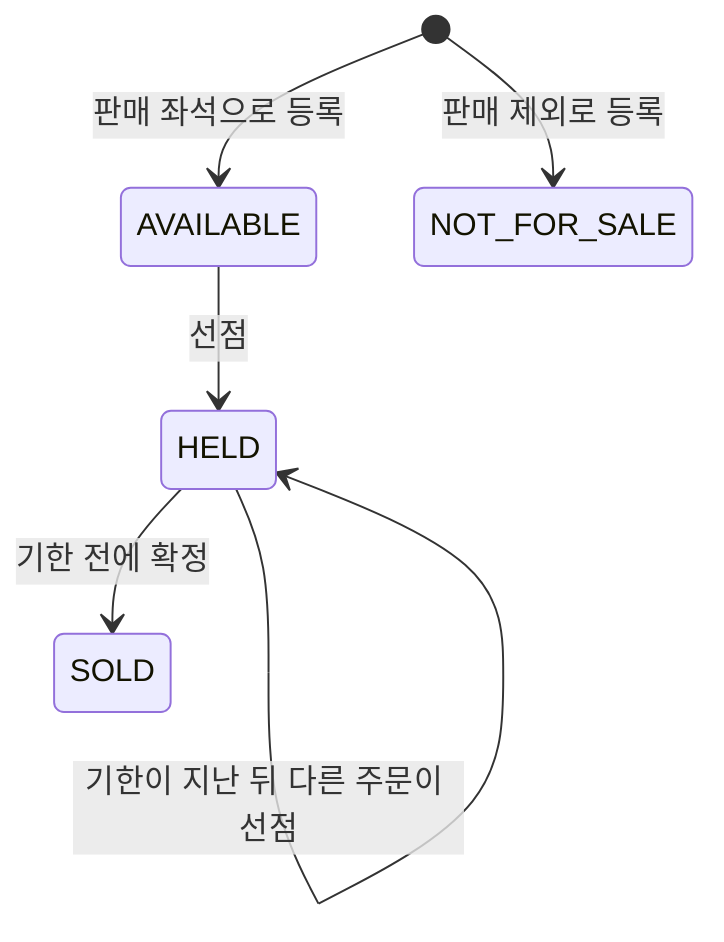
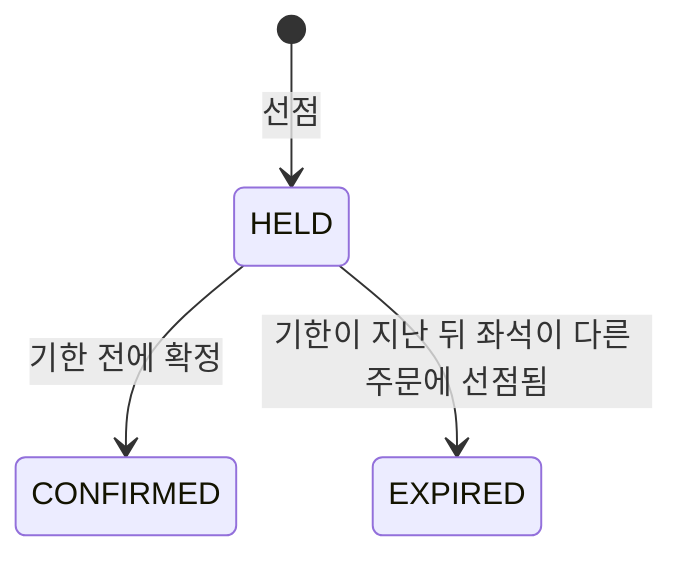
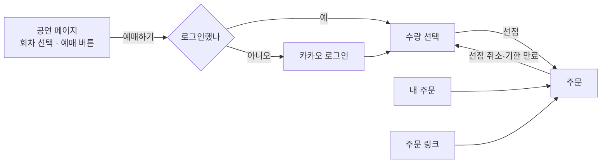

# 좌석 예매 흐름 기능 명세

기본 예약 흐름(P0)에서 구매자가 좌석을 고르고, 선점하고, 확정하기까지의 규칙을 정한다. 왜 이 서비스를 만드는지와 사용자, 제품 원칙은 [PRD](../product/prd.md)에 있다.

- 이 문서는 제품이 어떻게 동작하는지를 다룬다. 잠금 방식이나 격리 수준 같은 구현 방법은 다루지 않는다
- 규칙이 바뀌면 코드와 이 문서를 같은 PR에서 고친다

## 1. 범위

### 다루는 것

- 회차의 좌석 상태 조회
- 여러 좌석을 한 주문으로 선점하기
- 선점 기한이 지난 좌석의 만료와 재판매
- 선점한 주문의 확정
- 위 동작들이 동시에 일어날 때 지켜야 할 결과

### 이번 단계에서 다루지 않는 것

- 결제. 이번 단계에서는 구매자가 확정을 직접 요청한다. 결제가 들어오면(P2) 결제 승인이나 입금 알림이 같은 확정을 요청한다
- 주최자 기능. 공연·회차·좌석은 로컬 개발용 샘플 데이터로 만든다
- 환불, 입장 확인, 현장 판매

## 2. 용어

| 용어 | 뜻 |
|---|---|
| 공연 | 작품 하나. 제목을 가진다 |
| 회차 | 공연이 열리는 한 번. 시작 시각과 판매 조건(판매 시작 시각, 선점 유지 시간, 1인 최대 좌석 수)을 가진다 |
| 좌석 | 회차에서 팔 수 있는 한 자리. 지정석과 자유석이 있다 |
| 지정석 | 정해진 자리. 좌석 번호(예: `A1`)로 구분한다 |
| 자유석 | 자리 대신 입장 순서를 파는 표. 입장번호(예: `1`, `2`)로 구분하고, 지정석과 같은 규칙으로 판다 |
| 선점 | 구매자가 결제나 확정 전에 좌석을 잠시 잡아 두는 것. 선점 기한까지 다른 사람이 살 수 없다 |
| 선점 기한 | 선점이 유효한 마지막 순간. 선점한 시각에 회차의 선점 유지 시간을 더한 값이다 |
| 주문 | 한 번의 선점 요청으로 잡은 좌석 묶음. 주문 단위로 확정한다 |
| 확정 | 선점한 주문을 판매로 굳히는 것. 확정한 좌석은 다시 팔리지 않는다 |
| 판매 제외 좌석 | 주최자가 팔지 않기로 한 좌석. 시야 제한석이나 현장 판매분 등 |

## 3. 구매 흐름

1. 구매자가 회차의 좌석 상태를 조회한다
2. 좌석을 하나 이상 골라 선점을 요청한다. 고른 좌석을 모두 선점할 수 있을 때만 주문이 만들어진다
3. 선점 기한 안에 주문을 확정한다
4. 기한 안에 확정하지 않으면 그 좌석은 기한부터 다시 팔린다

## 4. 상태와 전이

### 좌석 상태

| 상태 | 뜻 | 구매자에게 보이는 상태 |
|---|---|---|
| `AVAILABLE` | 선점할 수 있다 | `AVAILABLE` |
| `HELD` | 어떤 주문이 선점 중이다 | 기한 전이면 `HELD`, 기한부터는 `AVAILABLE` |
| `SOLD` | 확정되어 팔렸다 | `SOLD` |
| `NOT_FOR_SALE` | 판매하지 않는다 | `NOT_FOR_SALE` |

- 기한이 지난 `HELD` 좌석은 저장된 상태를 바꾸지 않아도 선점할 수 있는 좌석으로 본다. 조회에서도 `AVAILABLE`로 보여 준다
- `SOLD`와 `NOT_FOR_SALE`은 시각과 관계없이 선점할 수 없다

### 주문 상태

| 상태 | 뜻 |
|---|---|
| `HELD` | 좌석을 선점 중이다. 기한이 지나면 더 이상 확정할 수 없다 |
| `EXPIRED` | 기한이 지나 그 주문의 좌석이 다른 주문에 다시 선점됐다 |
| `CONFIRMED` | 확정됐다 |

- 기한이 지났지만 아무도 다시 선점하지 않은 주문은 `HELD`로 남는다. 이 주문은 확정할 수 없고 1인 최대 좌석 수에도 세지 않는다
- `EXPIRED`와 `CONFIRMED`는 다시 바뀌지 않는다
- 주문은 지우지 않는다. 만료된 주문도 상태로 남긴다

## 5. 규칙

### 시각

- 모든 판단은 서버의 현재 시각으로 한다. 시각은 UTC로 저장하고 마이크로초까지 다룬다
- 시각 경계는 "그 시각부터"로 본다. 판매 시작 시각 정각에는 판매가 열려 있고, 선점 기한 정각에는 선점이 끝나 있다
- 선점은 서버가 요청을 받은 시각으로 판단하고, 확정은 차례를 기다린 뒤 처리하는 시각으로 판단한다. 경계에서 애매하면 둘 다 거부하는 쪽으로 판단한다

### 좌석 조회

- 회차의 좌석을 등록한 순서대로 돌려준다. 좌석마다 ID, 종류(지정석·자유석), 번호, 상태를 준다
- 상태는 조회한 시각 기준이다. 기한이 지난 `HELD`는 `AVAILABLE`로 준다

### 선점

- 판매 시작 시각 전에는 선점할 수 없다
- 한 번에 여러 좌석을 요청할 수 있다. 하나라도 선점할 수 없으면 주문 전체를 거부한다. 일부만 잡힌 주문은 만들지 않는다
- 좌석 목록이 비었거나 같은 좌석이 두 번 들어 있으면 요청 형식 오류로 거부한다
- 요청한 회차에 속하지 않는 좌석이나 없는 좌석이 있으면 거부하고 그 좌석을 알려 준다
- 선점할 수 없는 좌석(선점 중, 판매 완료, 판매 제외)이 있으면 거부하고 그 좌석을 알려 준다
- 선점하면 주문이 만들어지고, 주문과 좌석에 같은 선점 기한이 기록된다. 응답의 좌석은 좌석 ID 순서다

### 만료와 재판매

- 선점 기한부터 그 좌석은 누구나 다시 선점할 수 있다. 원래 구매자도 다시 선점할 수 있다
- 기한이 지난 좌석을 다시 선점하면, 그 좌석의 이전 주문은 `EXPIRED`가 되고 좌석은 새 주문에 속한다
- 한 주문의 좌석이 서로 다른 주문에 따로 다시 선점되어도 이전 주문은 한 번만 `EXPIRED`가 된다

### 1인 최대 좌석 수

- 한 구매자가 한 회차에서 가질 수 있는 좌석 수의 상한이다. 회차마다 정한다
- 셀 때 넣는 것: 기한이 남은 `HELD` 주문의 좌석, `CONFIRMED` 주문의 좌석
- 셀 때 빼는 것: 기한이 지난 주문의 좌석, `EXPIRED` 주문의 좌석
- 이번 요청의 좌석 수를 더해 상한을 넘으면 거부한다
- 구매자는 지금 요청 본문의 사용자 번호로 구분한다. 카카오 로그인이 들어오면 로그인한 계정으로 구분한다(7절)

### 확정

- 주문을 만든 구매자만 확정할 수 있다
- 선점 기한 전에만 확정할 수 있다. 기한 정각부터는 거부한다
- `EXPIRED` 주문은 확정할 수 없다
- 확정하면 주문은 `CONFIRMED`, 그 주문의 모든 좌석은 `SOLD`가 되고, 좌석의 선점 기한은 지운다. 주문의 선점 기한은 기록으로 남긴다
- 이미 확정한 주문을 다시 확정하면, 기한이 지난 뒤라도 처음과 같은 응답을 돌려주고 아무것도 바꾸지 않는다
- 확정 요청이 차례를 기다리는 사이 기한이 지나면 거부한다. 판단은 요청이 처리되는 시각 기준이다

### 동시 요청에서 지키는 결과

| 상황 | 결과 |
|---|---|
| 같은 좌석에 여러 구매자가 동시에 선점 | 한 명만 성공한다 |
| 겹치는 좌석을 서로 다른 순서로 동시에 선점 | 한 주문만 성공하고, 일부만 잡힌 주문은 없다 |
| 기한이 지난 좌석에 여러 구매자가 동시에 재선점 | 한 명만 성공한다 |
| 같은 구매자가 여러 좌석을 동시에 따로 선점 | 1인 최대 좌석 수를 넘지 않는다 |
| 기한 경계에서 원래 구매자의 확정과 다른 구매자의 재선점이 겹침 | 판단 시각(위 "시각" 규칙)이 기한 전인 확정과, 판단 시각이 기한 시각부터인 재선점만 성공할 수 있다. 둘 다 성공하지 않고, 좌석은 한 주문에만 속한다 |
| 같은 구매자가 기한 경계에서 확정과 다른 좌석 선점을 함께 보냄 | 1인 최대 좌석 수를 넘지 않는다 |
| 같은 주문에 확정이 동시에 여러 번 옴 | 모두 같은 응답을 받고, 한 번 확정한 것과 같은 상태다 |

## 6. 실패 상황

규칙 위반은 `409`와 함께 응답 본문의 `code`로 이유를 알린다. 문제 좌석이 있으면 `seatIds`로 알려 준다. 응답 본문은 RFC 9457 Problem Details 형식이다.

| 상황 | HTTP 상태 | `code` | `seatIds` |
|---|---|---|---|
| 판매 시작 전 선점 | 409 | `SALES_NOT_OPEN` | 없음 |
| 1인 최대 좌석 수 초과 | 409 | `SEAT_LIMIT_EXCEEDED` | 없음 |
| 회차에 없는 좌석 포함 | 409 | `SEAT_NOT_IN_SHOWTIME` | 해당 좌석 |
| 선점할 수 없는 좌석 포함 (선점 중, 판매 완료, 판매 제외) | 409 | `SEAT_NOT_AVAILABLE` | 해당 좌석 |
| 기한이 지났거나 만료된 주문 확정 | 409 | `ORDER_EXPIRED` | 없음 |
| 다른 구매자의 주문 확정 | 403 | `ORDER_NOT_OWNED` | 없음 |
| 없는 회차 조회·선점 | 404 | 없음 | 없음 |
| 없는 주문 확정 | 404 | 없음 | 없음 |
| 좌석 목록이 비었거나 중복, 필수 값 누락 | 400 | 없음 | 없음 |

- 다른 구매자의 주문은 지금 `403`이다. 카카오 로그인이 들어오면 남의 주문이 있다는 사실을 숨기도록 `404`로 바꾼다

## 7. 결정한 규칙

아직 구현하지 않은 규칙이다. 구현은 각각 이슈로 나눠 진행하고, 구현하면 위 1~6절로 옮긴다.

### 구매자 구분

- 구매자는 카카오 계정으로 로그인한다. 따로 가입하는 절차는 없다
- 받는 정보는 카카오 계정 식별값과 닉네임뿐이다. 닉네임은 예매자 이름으로 쓰고, 예매할 때 고칠 수 있다. 전화번호는 받지 않는다
- 1인 최대 좌석 수는 구매자 식별 키로 센다. 지금은 카카오 계정이 키다. 네이버·구글 로그인이나 실명 확인을 붙여도 키를 만드는 방법만 늘어나고 선점·확정 규칙은 그대로다
- 선점, 확정, 취소, 내 주문 조회는 로그인해야 할 수 있다. 확정과 취소는 주문을 만든 구매자만 할 수 있다
- 다른 구매자의 주문은 있다는 사실도 알리지 않고 없는 주문처럼 답한다(`404`). 지금의 `403 ORDER_NOT_OWNED`는 로그인이 들어올 때 없앤다
- 카카오 계정이 없는 사람은 현장 판매로 산다(P3). 비회원 예매는 [PRD](../product/prd.md)의 열린 질문으로 남긴다

### 주문 링크와 QR

- 선점에 성공하면 주문마다 추측할 수 없는 주문 토큰을 발급한다. 토큰을 담은 주문 링크와 같은 토큰의 QR을 준다
- 주문 링크로는 로그인 없이 주문 화면을 볼 수 있다. 함께 갈 사람에게 표를 보여 주거나 입구에서 QR을 띄우는 용도다. 확정과 취소는 링크만으로는 할 수 없고, 주문을 만든 구매자가 로그인해야 한다
- 입장(P3)은 이 QR로 한다
- 링크를 잃어버려도 로그인하면 내 주문에서 다시 찾는다

### 주문 조회

- 로그인한 구매자는 내 주문 목록과 주문 상세를 본다. 주문 링크로도 주문 상세를 본다
- 주문 상세는 주문 상태, 입장번호, 회차 정보, 선점 기한을 준다
- 상태는 조회한 시각 기준이다. 기한이 지난 `HELD` 주문은 더 이상 확정할 수 없다는 것을 함께 알려 준다

### 선점 취소

- 구매자는 기한 전의 `HELD` 주문을 취소할 수 있다. 주문은 `CANCELLED`가 되고, 그 주문의 좌석은 바로 `AVAILABLE`이 된다
- 취소한 주문은 1인 최대 좌석 수에서 빠진다
- 이미 취소한 주문을 다시 취소하면 같은 응답을 돌려주고 아무것도 바꾸지 않는다
- 확정한 주문은 취소할 수 없다. 확정 뒤의 취소는 환불이며 P2에서 다룬다
- 기한이 지났거나 만료된 주문은 취소할 수 없다. 좌석은 이미 다시 팔 수 있는 상태다
- 취소한 주문은 확정할 수 없다

### 기본 판매 방식

- 자유석을 기본 판매 방식으로 둔다. 대상 고객인 라이브 클럽·소규모 공연은 스탠딩이나 자유석이 많다
- 지정석도 지금처럼 판다. 좌석 배치 정보는 주최자가 좌석을 등록할 때 처음 생기는 데이터여서, 좌석 배치와 지정석 등록은 주최자 좌석 등록(P3)과 함께 만든다
- 구매자 화면의 기본 흐름은 "수량 선택 → 입장번호 자동 배정"이다

### 자유석 배정

- 자유석은 구매자가 입장번호를 고르지 않고 수량만 고른다
- 남은 입장번호 가운데 가장 앞 번호부터 차례로 배정한다. 취소나 만료로 앞 번호가 다시 비면 그 번호부터 배정한다
- 여러 장을 사면 번호가 이어지지 않을 수 있다
- 같은 번호가 두 주문에 배정되지 않는 것은 지정석과 같이 지킨다

### 회차의 좌석 종류

- 한 회차는 지정석만 팔거나 자유석만 판다. 섞지 않는다

### 판매 마감

- 회차에 공연 종료 시각과 판매 마감 시각을 둔다
- 판매 마감 시각을 따로 정하지 않으면 공연 종료 시각까지 판다. 주최자는 마감을 앞당길 수 있다
- 시각은 다음 순서를 지켜야 한다: 판매 시작 < 공연 시작 < 공연 종료, 판매 시작 < 판매 마감 ≤ 공연 종료
- 판매 마감 시각 정각부터는 새 선점을 받지 않는다
- 마감 전에 잡은 선점은 원래 선점 기한까지 확정할 수 있다

### 1인 최대 좌석 수의 단위

- 회차 단위를 유지한다. 공연 단위로 세면 회차가 여럿인 공연에서 다른 날 공연을 살 수 없다

### 좌석 배치

- 지정석은 구역, 행 이름, 좌석 번호와 화면에 그릴 칸 위치(몇째 줄, 몇째 칸)를 가진다
- 칸 위치를 좌석 번호와 따로 두어서 통로, 들여쓰기, 층·구역 구분을 그린다. 예: A열 6번이 통로 다음 7번째 칸에 있는 경우
- 자유석은 배치 정보 없이 남은 수만 보여 준다
- 주최자 좌석 등록(P3)과 함께 만든다. 이번 단계의 구매자 화면은 자유석 흐름을 기본으로 한다
- 배치는 회차의 좌석마다 저장한다. 같은 공연장을 여러 회차에 쓰는 경우의 배치 재사용(공연장 배치 템플릿)은 주최자 좌석 등록을 만들 때(P3) 검토한다

### 실패 상황 추가

| 상황 | HTTP 상태 | `code` |
|---|---|---|
| 판매 마감 뒤 선점 | 409 | `SALES_CLOSED` |
| 취소한 주문 확정 | 409 | `ORDER_CANCELLED` |
| 확정한 주문 취소 | 409 | `ORDER_CONFIRMED` |
| 기한이 지났거나 만료된 주문 취소 | 409 | `ORDER_EXPIRED` |
| 자유석 남은 수보다 많이 요청 | 409 | `SEAT_NOT_AVAILABLE` |
| 로그인하지 않고 선점·확정·취소·내 주문 조회 | 401 | 없음 |

## 8. 화면 구조

구매자 화면의 구조다. 7절의 결정(자유석 기본, 주문 토큰, 선점 취소, 판매 마감)이 구현된 상태를 기준으로 한다. 이번 단계에는 결제가 없으므로 "확정" 버튼이 결제를 대신한다.

### 화면 흐름

- 대형 예매처처럼 공연 페이지 안에서 회차를 고르고, 판매가 열리면 예매 버튼을 누른다
- 판매 전에 공연 페이지에서 미리 로그인해 두면, 판매가 열린 순간 수량만 고르고 바로 선점한다. 로그인하지 않았으면 예매 버튼을 누를 때 카카오 로그인을 거친다
- 선점 완료, 확정 완료, 주문 상세는 같은 "주문" 화면이다. 내 주문이나 주문 링크로 열리고, 주문 상태에 따라 내용이 바뀐다

### 화면별 정보와 동작

#### 공연 페이지

| 보여 줄 정보 | 동작 |
|---|---|
| 공연 제목, 장소, 공연 시작·종료 시각 | 회차를 고른다. 회차가 하나면 처음부터 골라져 있다 |
| 회차마다 판매 상태: 판매 전(판매 시작 시각), 판매 중, 매진, 판매 마감 | 판매 전이면 예매 버튼에 판매 시작까지 남은 시간을 보여 준다. 시간이 되면 새로고침 없이 버튼이 열린다 |
| 판매 중인 회차의 남은 수, 1인 최대 좌석 수 | 판매 중이면 예매 버튼을 눌러 수량 선택으로 간다 |
| 로그인 상태 | 로그인하지 않았으면 카카오 로그인 버튼을 보여 준다. 판매 전에 미리 로그인해 둘 수 있다 |

#### 수량 선택

| 보여 줄 정보 | 동작 |
|---|---|
| 고른 회차, 남은 수 | 수량을 고른다. 1인 최대 좌석 수에서 이미 가진 수를 뺀 만큼까지 고를 수 있다 |
| 1인 최대 좌석 수와 이미 가진 수, 예매자 이름(카카오 닉네임) | 예매자 이름을 고칠 수 있다. 선점을 누르면 선점하고 주문 화면으로 간다 |

#### 내 주문

| 보여 줄 정보 | 동작 |
|---|---|
| 로그인한 구매자의 주문 목록. 주문마다 공연, 회차, 수량, 주문 상태 | 주문을 누르면 주문 화면으로 간다 |

#### 주문

주문 토큰을 가진 링크로 연다. 화면은 공연 이름, 회차, 입장번호, QR을 한 장에 담은 모바일 티켓 카드 모양이다. 상태마다 보이는 내용이 다르다.

| 주문 상태 | 보여 줄 정보 | 동작 |
|---|---|---|
| 선점 중 | 배정된 입장번호, 회차, 선점 기한까지 남은 시간 | 확정, 선점 취소, 공유하기 |
| 확정 | 티켓 카드(입장번호, 회차, 입장용 QR) | 이미지로 저장, 캘린더에 추가, 공유하기 |
| 기한 지남·만료 | 기한이 지나 확정할 수 없다는 안내 | 다시 고르기(수량 선택으로) |
| 취소 | 취소했다는 안내 | 다시 고르기(수량 선택으로) |

- 확정과 선점 취소 버튼은 주문을 만든 구매자가 로그인했을 때만 보인다. 주문 링크로 들어온 다른 사람은 주문 내용과 QR만 본다
- 주문은 로그인하면 내 주문에서 언제든 다시 찾는다. 그 밖에 표를 손에 남기는 수단은 세 가지다. 모두 비용 없이 화면에서 처리한다
  - 이미지로 저장: 티켓 카드를 사진첩에 저장한다. 인터넷이 안 되는 공연장 입구에서도 QR을 보여 줄 수 있다
  - 캘린더에 추가: 휴대폰 캘린더에 회차 일정과 주문 링크를 넣는다. 공연 전 알림을 받는다
  - 공유하기: 휴대폰의 공유 창으로 원하는 곳에 주문 링크를 보낸다. 공유 창이 없는 브라우저에서는 링크를 복사한다
- QR 이미지는 퍼질 수 있다. 같은 QR은 입장에서 한 번만 통과시킨다(P3)
- 남은 시간은 서버 시각에 맞춰 줄어들게 보여 주지만, 할 수 있는지는 서버가 판단한다. 화면의 시간이 남아 있어도 서버가 거부하면 거부 이유를 보여 준다
- 예매 버튼이 열린 직후 서버가 아직 판매 전이라고 답하면, 화면이 잠시 뒤 자동으로 다시 시도한다

### 실패 상황별 화면

| 실패 | 어디서 | 화면이 보여 줄 것 | 다음 동작 |
|---|---|---|---|
| `SALES_NOT_OPEN` | 선점 | 아직 판매 전이다 | 잠시 뒤 자동으로 다시 시도 |
| `SALES_CLOSED` | 선점 | 판매가 끝났다 | 공연 페이지로 |
| `SEAT_NOT_AVAILABLE` | 선점 | 고르는 사이 남은 수가 줄었다. 새 남은 수 | 수량을 줄여 다시 시도. 0이면 매진 안내 |
| `SEAT_LIMIT_EXCEEDED` | 선점 | 1인 최대 좌석 수와 이미 가진 수 | 수량을 줄여 다시 시도 |
| `ORDER_EXPIRED` | 주문 (확정·취소) | 선점 기한이 지났다 | 다시 고르기 |
| `ORDER_CANCELLED` | 주문 (확정) | 이미 취소한 주문이다 | 다시 고르기 |
| `ORDER_CONFIRMED` | 주문 (취소) | 이미 확정한 주문이라 여기서 취소할 수 없다 | 없음 |
| 없는 주문 | 주문 링크 | 주문을 찾을 수 없다. 링크를 확인하라 | 공연 페이지로 |
| 응답을 받지 못함 | 선점·확정 | 처리됐는지 알 수 없다 | 확정은 다시 눌러도 된다(재확정은 같은 결과). 선점은 주문 링크를 받지 못했으면 다시 시도 |

### 화면마다 필요한 데이터

API 명세는 이 표를 기준으로 쓴다.

| 화면 | 필요한 데이터 | 지금 API |
|---|---|---|
| 공연 페이지 | 공연 제목·장소, 회차 목록(공연 시작·종료 시각, 판매 시작·마감 시각, 좌석 종류, 판매 상태, 남은 수, 1인 최대 좌석 수), 서버 현재 시각(남은 시간 계산용) | 없다 |
| 모든 화면 | 로그인 상태, 로그인한 구매자의 닉네임 | 없다 |
| 수량 선택 | 남은 수, 로그인한 구매자가 이 회차에서 이미 가진 수 | 남은 수는 좌석 목록 조회로 셀 수 있다. 이미 가진 수는 없다 |
| 내 주문 | 로그인한 구매자의 주문 목록 | 없다 |
| 주문 | 주문 상태, 입장번호, 회차 정보, 선점 기한, 서버 현재 시각, 주문 토큰, 보는 사람이 주문을 만든 구매자인지 | 주문을 만들 때의 응답뿐이다. 조회는 없다 |

### 다음 단계의 화면

| 단계 | 화면 |
|---|---|
| 결제(P2) | 주문 화면의 확정 대신 결제. 가상계좌는 입금 계좌와 기한을 주문 화면에 보여 준다. 확정 뒤 취소(환불) |
| 주최자 운영·입장·배포(P3) | 지정석 좌석 배치도 선택(수량 선택을 대신함), 입장 담당의 QR 확인, 셀프 체크인, 현장 구매, 주문 화면의 홈 화면 추가와 오프라인 열기 |
| 주최자 화면(P2·P3) | 공연·회차·좌석 등록, 판매 현황, 주문 목록, 현금 판매. 남은 수를 구매자에게 숨기는 설정도 이때 검토한다 |

## 9. 다음 단계에서 바뀌는 것

| 단계 | 바뀌는 것 |
|---|---|
| 기본 예약 흐름(P0)의 남은 작업 | 카카오 로그인이 들어오면 1인 최대 좌석 수를 구매자 식별 키로 세고, 다른 구매자의 주문은 `403` 대신 `404`로 답한다 |
| 결제(P2) | 확정을 구매자가 아니라 결제 승인이나 입금 알림이 요청한다. 좌석 등급별 가격, 환불 규칙, 확정 뒤 취소(환불)가 들어온다 |
| 주최자 운영·입장·배포(P3) | 주최자 로그인과 공연·회차·좌석 등록, 주문 QR 입장, 셀프 체크인, 현장 판매가 들어온다. 공연장 배치 템플릿을 검토한다 |
| 공정성(P5) | 같은 사람의 반복 요청 제한과 선점 남용 제한이 들어온다 |
